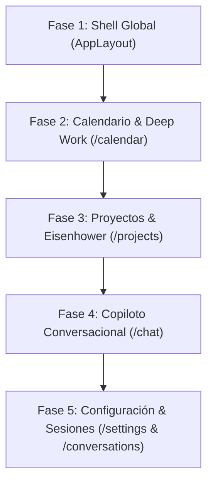

# 📋 Plan Maestro de Rediseño Post-Login — Fokus
> **Dirección Creativa:** *Luminous Liquid Glass & Focus Sanctuary*  
> **Modo de Superficie (Impeccable):** `Operate` (Cero fatiga cognitiva, claridad instantánea, blindaje de Deep Work)  
> **Estado:** Documento de referencia activo para la sesión de rediseño.

---

## 🔒 Reglas Fundamentales de Trabajo

1. **Entorno 100% Local:**  
   Todo el desarrollo, prototipado y ajustes se ejecutan exclusivamente en tu entorno local (`pnpm dev` en `http://localhost:3000`).
2. **CERO Git Push / CERO Despliegue a Producción sin Aprobación:**  
   Ningún cambio se enviará a Git ni a producción sin tu confirmación, inspección visual y visto bueno explícito previo.
3. **Coherencia Absoluta con la Landing Page:**  
   Se respeta y extiende la estética aprobada de la landing documentada en [`DESIGN.md`](./DESIGN.md):
   - **Lienzo Base:** Fondo orgánico cálido `#edece9` con sutiles halos ambientales en Sanctuary Teal (`#1c6662`) y Ámbar Miel (`#f4e0ba`).
   - **Cristal Líquido Refractivo:** Superficies translúcidas (`bg-white/80` a `bg-white/85`), desenfoque óptico (`backdrop-blur-xl`), micro-bisel interior (`border-white/85`) y sombras teñidas con el color del fondo.
   - **Tipografía Esculpida:** **Wix Madefor Display** para títulos/encabezados clave, **Space Grotesk** para datos de impacto/cronómetros, **DM Sans** para lectura y formularios, y **JetBrains Mono** para micro-badges técnicos.
   - **Eliminación del "SaaS-Card Kit" Genérico:** Prohibidas las cajas blancas cuadradas con bordes grises duros, sombras negras genéricas y tablas corporativas frías.

---

## 🗺️ Fases de Ejecución

---

### 🏛️ Fase 1: Shell Global de la Aplicación (`AppLayout.tsx`)
**Objetivo:** Crear el marco contenedor donde viven todas las páginas protegidas, garantizando que al iniciar sesión la experiencia visual mantenga la calma y el nivel estético de la landing.

- **Componentes Clave:**
  - **Sidebar de Navegación Líquida:** Barra lateral delgada, translúcida y no intrusiva con esquinas suaves, selector de rutas con halo sutil en Sanctuary Teal (`#1c6662`) y micro-indicadores de actividad.
  - **Header Superior Transparente:** Barra diáfana flotante (`bg-white/60 backdrop-blur-xl border-white/80`) con estado de conexión a Google Calendar, avatar de usuario refinado y botón de acción rápida.
  - **Lienzo Ambiental Unificado:** Fondo continuo `#edece9` sin cortes visuales bruscos entre rutas.
- **Archivos a intervenir:**
  - [`components/layout/AppLayout.tsx`](./components/layout/AppLayout.tsx)
  - [`app/(protected)/layout.tsx`](./app/(protected)/layout.tsx)

---

### 📅 Fase 2: Calendario y Bloques de Deep Work (`/calendar`)
**Objetivo:** Transformar la vista de calendario actual (densa y corporativa) en un timeline diáfano, inspirador y centrado en la protección del tiempo de alto valor.

- **Componentes Clave:**
  - **Timeline Diáfano de Foco:** Visualización de horas en cristal translúcido con slots de descanso y enfoque claramente diferenciados.
  - **Bloques Blindados de Deep Work:** Tarjetas con halo ámbar cálido (`#f4e0ba`) y borde teal (`#1c6662`), contador de cuenta regresiva en Space Grotesk y badge de sincronización en tiempo real.
  - **Controles de Navegación Temporal:** Selector de vista (Día / Semana / Mes) en píldoras fluidas y minimalistas.
- **Archivos a intervenir:**
  - [`app/(protected)/calendar/page.tsx`](./app/(protected)/calendar/page.tsx)
  - Componentes auxiliares de calendario en `components/calendar/`

---

### 📋 Fase 3: Proyectos, Kanban y Matriz Eisenhower (`/projects`) — ✅ COMPLETADO LOCALMENTE
**Objetivo:** Rediseñar la gestión de tareas para que priorizar sea natural, visualmente descansado y alejado de las hojas de cálculo aburridas.
- **Opción seleccionada:** *Option 1: Strategic Sanctuary (Eisenhower 2x2 Glass Matrix)*.
- **Componentes Creados:**
  - `components/projects/ProjectsHeader.tsx`: Pulso ejecutivo en Space Grotesk, buscador `/`, selector de vistas y filtro de proyectos.
  - `components/projects/EisenhowerMatrixView.tsx`: Matriz 2x2 en cristal líquido con halo y acción directa en Cuadrante II (Deep Work).
  - `components/projects/ProjectKanbanView.tsx`: Tablero Kanban por proyecto con micro-barras de progreso.
  - `components/projects/PriorityListView.tsx`: Agrupación por prioridad (Alta / Media / Baja).
  - `components/projects/TaskCard.tsx`: Tarjeta interactiva con checkbox circular táctil, metadatos a 11px, Google Calendar y atajo de Deep Work.
  - `components/projects/CreateTaskModal.tsx`: Modal esmerilado de captura rápida (`N`).
  - `components/projects/ShortcutsModal.tsx`: Menú accesible de atajos (`?`).
  - `components/projects/UndoToast.tsx`: Toast optimista flotante de 5 segundos con botón Deshacer.
  - `app/(protected)/projects/page.tsx`: Orquestador principal modularizado y limpio.
- **Validación:** `pnpm build` (15/15 páginas, exit 0) e `impeccable detect` (0 anti-patrones).

---

### 💬 Fase 4: Copiloto de Crecimiento & Chat AI (`/chat`)
**Objetivo:** Afinar la experiencia de chat sobre el prototipo de Santuario Líquido implementado, incorporando tu retroalimentación en directo.

- **Componentes Clave:**
  - **Burbujas Conversacionales:** Pulir contrastes y sensaciones táctiles de las respuestas del copiloto.
  - **Tarjeta Deep Work Interactiva:** Cronómetro radial animado con controles integrados de inicio/pausa de sesión de enfoque.
  - **Barra de Entrada Suspendida:** Píldora curva inferior (`backdrop-blur-2xl`) con botones de capacidades rápidas (Pomodoro, Calendar, Priorizar).
- **Archivos a intervenir:**
  - [`app/(protected)/chat/page.tsx`](./app/(protected)/chat/page.tsx)
  - [`components/chat/ChatWindow.tsx`](./components/chat/ChatWindow.tsx)
  - [`components/chat/ChatInput.tsx`](./components/chat/ChatInput.tsx)
  - [`components/chat/DeepWorkCard.tsx`](./components/chat/DeepWorkCard.tsx)
  - [`components/chat/MessageBubble.tsx`](./components/chat/MessageBubble.tsx)

---

### ⚙️ Fase 5: Configuración y Sesiones (`/settings` & `/conversations`)
**Objetivo:** Espacios de apoyo limpios, directos y placenteros de usar.

- **`/settings`:** Formularios con espaciado generoso, interruptores táctiles en Sanctuary Teal y tarjetas de integración claras (Google Calendar, Notificaciones, Preferencias).
- **`/conversations`:** Historial de sesiones de foco previas organizadas cronológicamente con tarjetas de resumen ligeras.
- **Archivos a intervenir:**
  - [`app/(protected)/settings/page.tsx`](./app/(protected)/settings/page.tsx)
  - [`app/(protected)/conversations/page.tsx`](./app/(protected)/conversations/page.tsx)

---

## 🔄 Protocolo de Validación por Pantalla

Para cada una de las fases anteriores, seguiremos este circuito estricto:

1. **Diseño & Maquetación:** Implementación en código limpio, modular y tipado siguiendo las directrices de `impeccable` y `DESIGN.md`.
2. **Auditoría Técnica:** Ejecución de `pnpm build` para asegurar cero errores de TypeScript y rendimiento óptimo.
3. **Revisión en Vivo por el Usuario:** Se levanta el servidor local (`pnpm dev` en `http://localhost:3000`). Tú entras, pruebas la pantalla en tu navegador, evalúas la sensación visual e interactiva.
4. **Ronda de Ajustes:** Aplicamos los cambios que indiques hasta que quede exactamente como quieres.
5. **Aprobación Formal:** Solo tras tu "visto bueno", se da por cerrada la fase y avanzamos a la siguiente.
